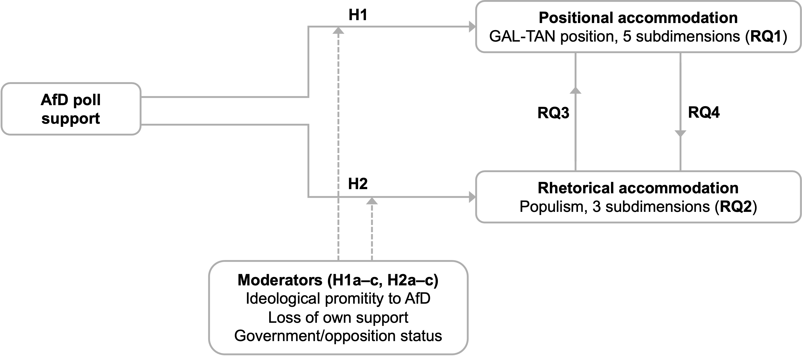

# Following, Not Catching Up? Joint Measurement of Positional and Rhetorical Accommodation to a Right-Wing Populist Party Using a Single LLM Pipeline

This repository contains the Python scripts and key data files for a quantitative analysis of speeches in the German Bundestag. It examines whether and how mainstream parties move closer to the AfD, both rhetorically and in their positions. The analysis combines LLM-based content coding, survey data, aggregation at the polling-interval level, and regression models for the hypotheses and research questions of the thesis.

## Research Interest

The project aims to examine the influence of the AfD's success on the communication and issue positioning of mainstream parties. It focuses on two forms of convergence:

1. **Positional convergence**: Changes in the distance between mainstream parties and the AfD on the GAL-TAN dimension.
2. **Rhetorical convergence**: Changes in the populist communication of mainstream parties.

The central hypotheses test whether higher support for the AfD is associated with smaller positional distances and with more populist communication by mainstream parties. In addition, the analysis examines moderation effects of ideological proximity, vote losses, and government/opposition status, as well as differences between subdimensions.

The following research model summarizes the relationships and moderation effects under investigation:



## Data

The Bundestag speeches come from the **Corpus of Plenary Protocols of the German Bundestag (CPP-BT)** by Sean Fobbe. The speech-level Parquet file is used:
```text
CPP-BT_2026-01-17_DE_PQT_Reden_Gesamt.parquet
```

Because of its size, this file is **not included in the repository**. To fully reproduce the data preparation, it must be downloaded separately and placed locally at the following path:
```text
data/raw/CPP-BT_2026-01-17_DE_PQT_Reden_Gesamt.parquet
```

The speech variant used contains individual speeches and metadata such as `rede_id`, `rede_text`, `wahlperiode`, `sitzung_datum`, `redner_fraktion`, `redner_rolle_kurz`, and `redner_rolle_lang`.

In addition, polling data from Infratest dimap and manual validation data are used. These smaller raw data files are included in the repository:
```text
data/raw/infratest_dimap.xlsx
data/raw/manual_validation.csv
data/raw/manual_validation.xlsx
```

## Project Structure
```text
.
├── src/                              # Python scripts of the analysis pipeline
├── data/
│   ├── raw/                          # smaller raw data on GitHub; large CPP-BT Parquet file kept locally
│   ├── interim/                      # optional intermediate data, not on GitHub
│   └── processed/
│       └── final_analysis/           # final analysis datasets, on GitHub
├── results/                          # model outputs, tables, and figures, on GitHub
├── outputs/                          # auxiliary outputs, not on GitHub
├── requirements.txt                  # runtime dependencies
├── requirements-dev.txt              # optional development dependencies
├── .gitignore
└── README.md
```

## Installation

A virtual environment is recommended.
```bash
python -m venv .venv
source .venv/bin/activate
pip install -r requirements.txt
```

On Windows:
```bash
python -m venv .venv
.venv\Scripts\activate
pip install -r requirements.txt
```

For working with Jupyter or formatting tools, you can additionally install the development dependencies:
```bash
pip install -r requirements-dev.txt
```

## API Key for LLM Coding

LLM coding requires an OpenAI API key. It is **not** committed to the repository. Store it locally in a `.env` file instead:
```text
OPENAI_API_KEY=your_api_key
```

The `.env` file is excluded via `.gitignore`. A `.env.example` is included in the repository.

Important: Only re-run the LLM coding scripts if re-coding is truly intended. To replicate the downstream analyses, you can use the LLM scores that have already been generated, or the final analysis datasets.

## Pipeline and Script Order

### 1. CPP-BT Data Preparation
```text
01_load_cppbt.py
02_clean_cppbt.py
03_add_government_status_cppbt.py
04_test_sample.py
05_print_speeches.py
```

### 2. Validation of the LLM Coding
```text
06_validation_sample.py
07_validation_llm_coding.py
08_face_validation.py
09_reliability_validation.py
```

`07_validation_llm_coding.py` contains the LLM-based coding of the validation sample. The prompt, JSON schema, model parameters, and parsing logic should not be changed if comparability with the existing results is to be preserved.

### 3. Final LLM Coding and Score Construction
```text
10_final_llm_coding.py
11_scores.py
12_merging.py
```

`10_final_llm_coding.py` codes the final speech sample. `11_scores.py` computes populism and GAL-TAN scores. `12_merging.py` merges the original speech data with the LLM scores.

### 4. Polling Intervals and Descriptive Statistics
```text
13_polling_intervals.py
14_descriptive_statistics.py
```

These scripts assign speeches to polling intervals, aggregate the data at the party and mainstream levels, and produce descriptive statistics.
Note: The file `data/processed/final_analysis/02_speech_level_with_polling.csv` is not included in the repository because of GitHub's file size limit. It is a generated intermediate/analysis file and can be reproduced by running the preprocessing and merging pipeline. The smaller aggregated final analysis datasets in `data/processed/final_analysis/` are included in the repository.

### 5. H1 to H1c: Positional Convergence
```text
15_hypothesis1.py
16_hypothesis1_mainstream.py
17_hypothesis1a.py
18_hypothesis1b.py
19_hypothesis1c.py
```

These scripts test the relationship between AfD support and positional convergence on the GAL-TAN dimension. They include models at the party-interval level and at the aggregated mainstream level, as well as moderation analyses.

### 6. RQ1
```text
20_research_question1.py
```

RQ1 examines whether the GAL-TAN subdimensions differ in their relationship with AfD support.

### 7. H2 to H2c: Rhetorical Convergence
```text
21_hypothesis2.py
22_hypothesis2_mainstream.py
23_hypothesis2a.py
24_hypothesis2b.py
25_hypothesis2c.py
```

These scripts test the relationship between AfD support and the populist communication of mainstream parties.

### 8. RQ2
```text
26_research_question2.py
```

RQ2 examines whether the populism subdimensions differ in their relationship with AfD support.

### 9. RQ3/RQ4, Additional AfD Analysis, and Final Figures
```text
27_research_question3_4.py
28_afd_check.py
29_figures.py
```

RQ3/RQ4 analyze the relationship between rhetorical and positional convergence. `28_afd_check.py` additionally checks whether the AfD itself changes over time or with increasing support. `29_figures.py` produces the final figures.

## Key Final Analysis Datasets

The most important final datasets are located in:
```text
data/processed/final_analysis/
```

Particularly relevant are:
```text
03_party_polling_interval.csv
04_mainstream_polling_interval.csv
05_party_polling_interval_distances.csv
06_mainstream_polling_interval_distances.csv
```

These files are deliberately version-controlled on GitHub because they form the basis of the final analyses.

## Results

The result files are located in:
```text
results/
```

This folder is also deliberately version-controlled on GitHub. It contains model outputs, tables, and figures for the hypotheses and research questions.

## Notes on Reproduction

To fully reproduce the entire pipeline, the large CPP-BT Parquet file must be added locally:
```text
data/raw/CPP-BT_2026-01-17_DE_PQT_Reden_Gesamt.parquet
```

The smaller raw data files `infratest_dimap.xlsx`, `manual_validation.csv`, and `manual_validation.xlsx` are included in the repository. The LLM scripts can incur API costs and may be affected by model versions or API behavior. To reproduce the statistical analyses, it is therefore advisable to use the version-controlled final analysis datasets and result files, unless re-coding is planned.

## GitHub Notes

This repository is set up so that sensitive files, local environments, auxiliary outputs, and large raw data are excluded, while smaller raw data, final analysis datasets, and results are version-controlled:

- `.env`, `.venv/`, `data/interim/`, other `data/processed/` files, `outputs/`, and large Parquet files in `data/raw/` are ignored.
- `data/raw/infratest_dimap.xlsx`, `data/raw/manual_validation.csv`, `data/raw/manual_validation.xlsx`, `data/processed/final_analysis/`, and `results/` can be uploaded to GitHub.